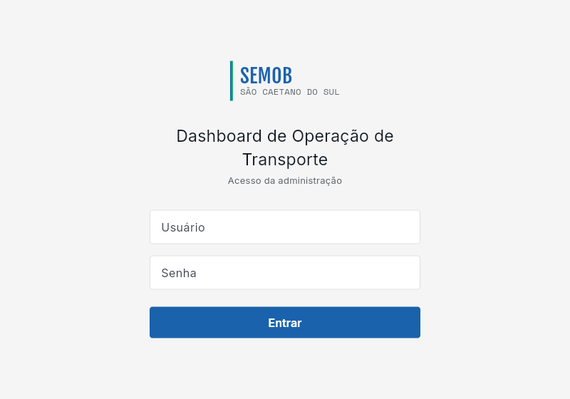
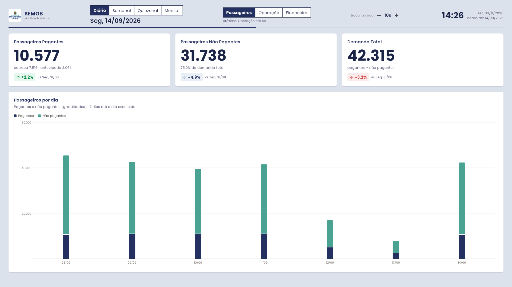
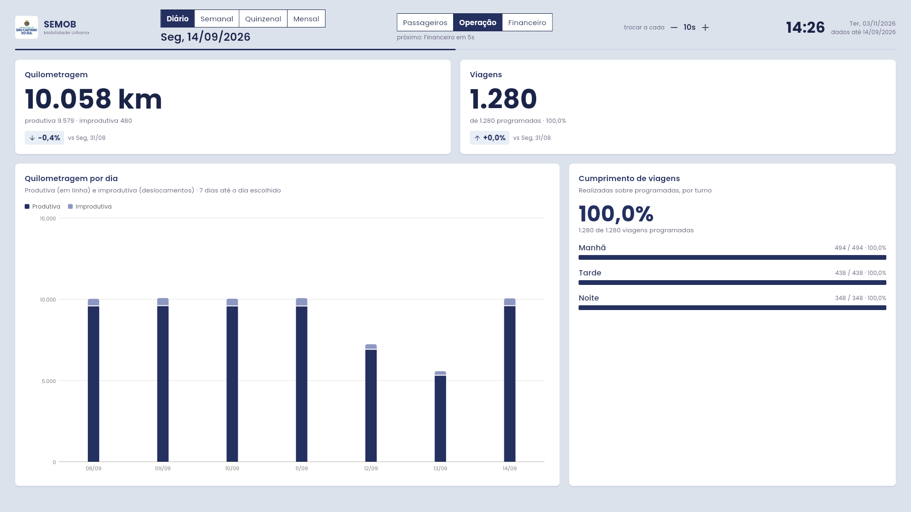
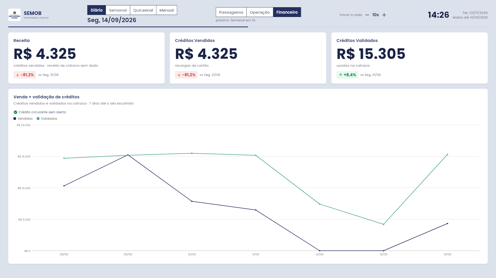
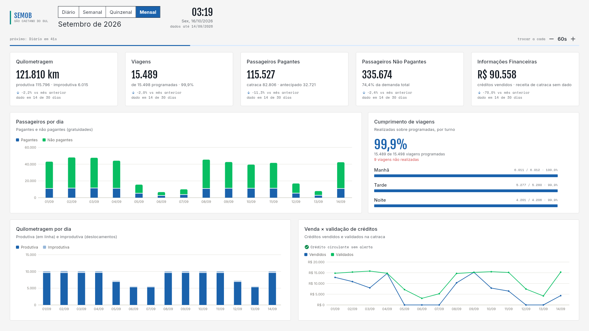
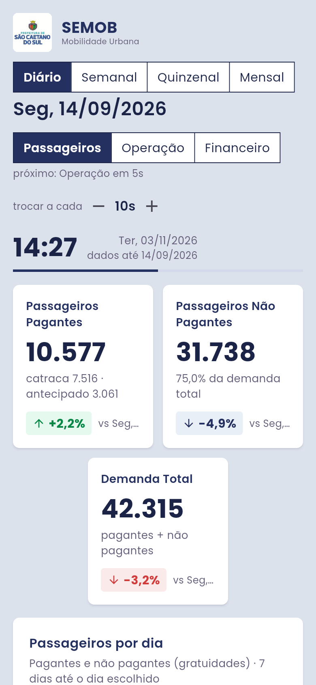
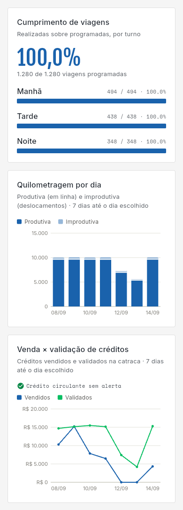

# PROJETOBUS: Dashboard de Operação de Transporte (SEMOB-SCS)

Painel da Secretaria de Mobilidade Urbana de São Caetano do Sul (SEMOB) que substitui os relatórios
estáticos recebidos por e-mail.

O dashboard foi feito para ficar aberto no **computador da SEMOB, ligado 24 horas** a uma tela grande, com o navegador em tela cheia: não tem botões. Ele mostra quilometragem,
viagens, passageiros pagantes, passageiros não pagantes e informações financeiras, com gráficos e
comparação com o período anterior. As informações são divididas em três telas por assunto
(**Passageiros, Operação e Financeiro**), que trocam sozinhas a cada 20 segundos; depois das três, o painel
passa para o próximo período (**diário, semanal, quinzenal e mensal**), então cada período fica 1 minuto
na tela. As cores, a fonte (Poppins) e o brasão seguem o site da Prefeitura de São Caetano do Sul.

Um único endereço serve tudo: o backend (Node.js) entrega a API e o painel (Flutter Web). Os dados ficam
no MongoDB Atlas e vêm dos relatórios do **Smart Report**.

---

# O que instalar antes

Instale no Windows (uma vez só):

| Programa | Para quê | Onde baixar |
|---|---|---|
| Git | baixar o projeto | https://git-scm.com/download/win |
| Node.js 20 ou mais novo | rodar o backend | https://nodejs.org |
| Flutter (versão estável) | compilar o painel | https://docs.flutter.dev/get-started/install/windows/web |
| Google Chrome | rodar o painel em modo de desenvolvimento | https://www.google.com/chrome |

Depois de instalar, feche o PowerShell e abra de novo para os comandos serem reconhecidos.

---

# Como instalar

Abra o PowerShell na pasta onde quer guardar o projeto e rode:

```
git clone https://github.com/Voidrotth/PROJETOBUS.git
```

## Backend

```
cd PROJETOBUS\backend
copy .env.example .env
npm install
```

## Frontend (painel)

```
cd ..\frontend
flutter pub get
flutter build web
```

O `flutter build web` gera o painel na pasta `frontend\build\web`. O backend passa a mostrá-lo no
endereço do sistema.

---

# Subir o link

```
[[[["C:\Program Files (x86)\cloudflared\cloudflared.exe" tunnel --url http://localhost:3100](https://multiple-prepared-identifying-macro.trycloudflare.com/)](https://multiple-prepared-identifying-macro.trycloudflare.com/)](https://multiple-prepared-identifying-macro.trycloudflare.com/)](https://multiple-prepared-identifying-macro.trycloudflare.com/)
```

---

# Telas

**Login** (todo acesso passa por aqui, inclusive o do computador da SEMOB)



**Painel, visão diária: Passageiros** (o dia é comparado com o mesmo dia da semana anterior; alta em verde, queda em vermelho)



**Painel, visão diária: Operação**



**Painel, visão diária: Financeiro**



**Painel, visão mensal: Passageiros**



**Painel no celular**

 
